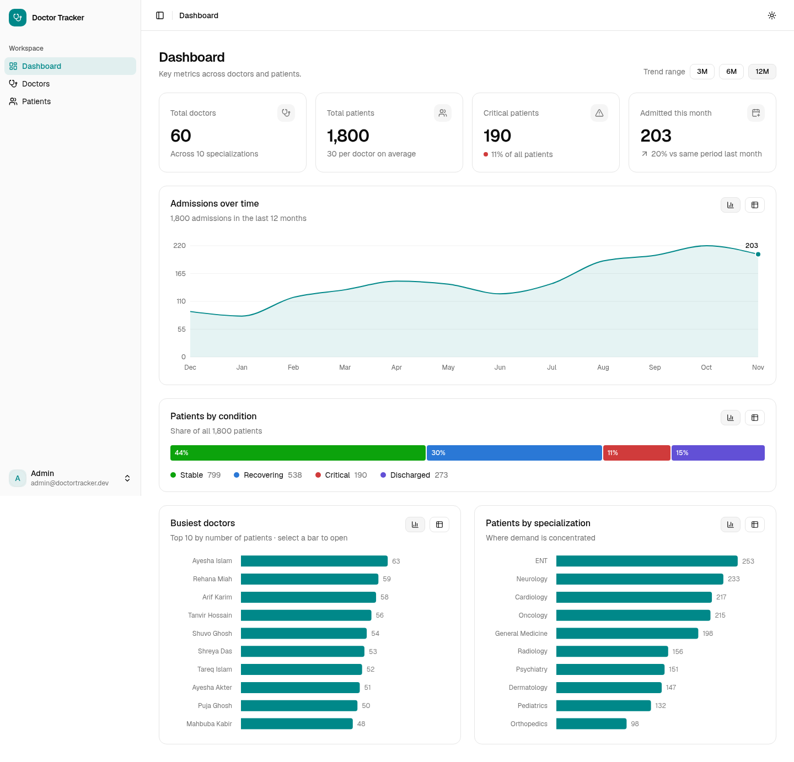
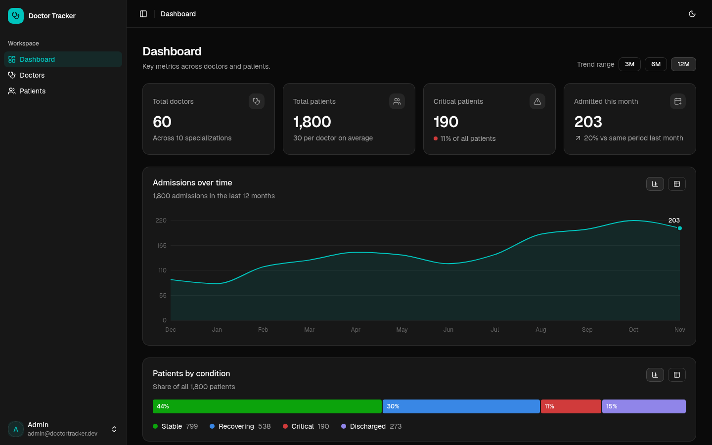
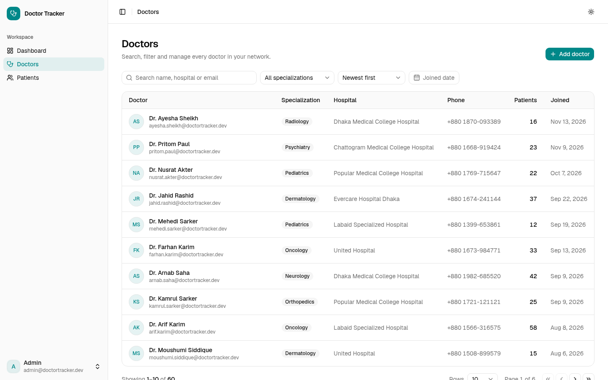
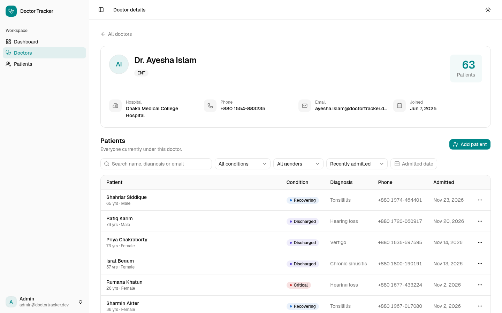
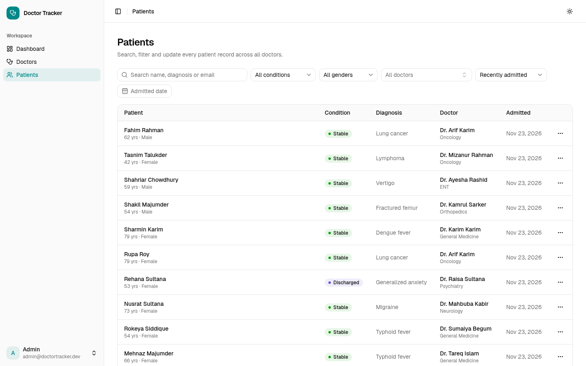
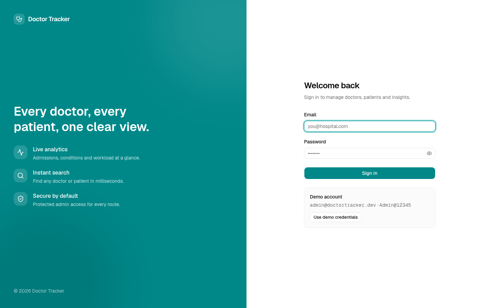
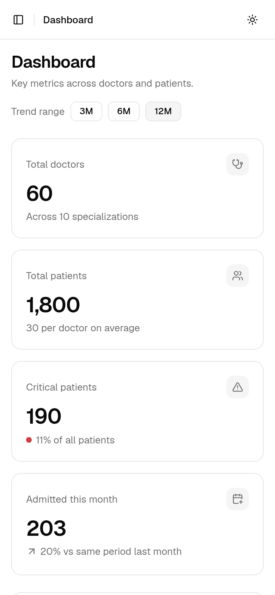
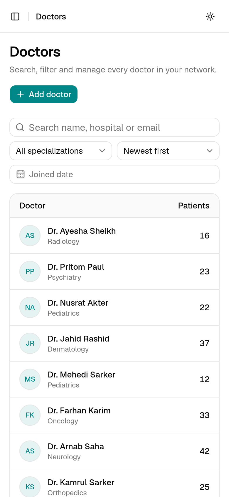
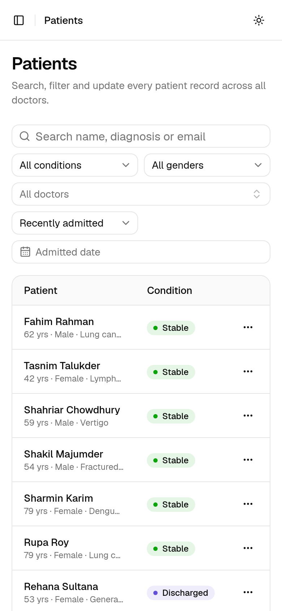

# Doctor Tracker

Doctor Tracker is an admin portal for managing doctors and their patients. An admin signs in, adds doctors, registers patients under a doctor and manages everyone through lists that can be searched, filtered and paginated. The dashboard shows total doctors and patients, admissions per month, the busiest doctors and how patients are spread across conditions and specializations. The frontend is a Next.js app and the backend is a separate Express API with MongoDB.

Demo login: `admin@doctortracker.dev` / `Admin@12345`

## Tech stack

- Frontend: Next.js 16, React 19, TanStack Query, nuqs, Tailwind CSS 4, shadcn/ui, Recharts
- Backend: Node.js 22, Express 5, Mongoose 9, Zod 4
- Database: MongoDB 8
- Monorepo: pnpm workspaces

## Setup guide

You need Node.js 22.9 or newer, pnpm 11 and a MongoDB 8 database (local, Docker or Atlas).

1. Clone the repo and install dependencies. This also builds the shared package.

   ```bash
   git clone <repo-url> doctor_tracker
   cd doctor_tracker
   pnpm install
   ```

2. Start MongoDB if you don't have one running.

   ```bash
   docker run -d --name doctor-tracker-mongo -p 27017:27017 mongo:8
   ```

3. Create the env files from the examples.

   ```bash
   cp apps/api/.env.example apps/api/.env
   cp apps/web/.env.example apps/web/.env.local
   ```

   Set `JWT_SECRET` in `apps/api/.env` to a random string of at least 32 characters, for example the output of `openssl rand -hex 32`.

4. Seed the database. This creates the admin user, 60 doctors and 1,800 patients. Running it again resets the data.

   ```bash
   pnpm seed
   ```

5. Start both apps.

   ```bash
   pnpm dev
   ```

   The web app runs on http://localhost:3000 and the API on http://localhost:4000.

### Environment variables

`apps/api/.env`

| Name                                      | Description                                                                                        |
| ----------------------------------------- | -------------------------------------------------------------------------------------------------- |
| `NODE_ENV`                                | `development` or `production`                                                                      |
| `PORT`                                    | API port, default `4000`                                                                           |
| `TRUST_PROXY`                             | Number of proxies in front of the API. `1` locally, `2` when the API sits behind Vercel and Render |
| `MONGODB_URI`                             | MongoDB connection string                                                                          |
| `JWT_SECRET`                              | Secret used to sign session tokens, at least 32 characters                                         |
| `SESSION_TTL_HOURS`                       | How long a login lasts, default `24`                                                               |
| `SEED_ADMIN_EMAIL`, `SEED_ADMIN_PASSWORD` | Admin account created by `pnpm seed`                                                               |

`apps/web/.env.local`

| Name                          | Description                                                                    |
| ----------------------------- | ------------------------------------------------------------------------------ |
| `API_URL`                     | Where the Express API runs. Only used on the server, never sent to the browser |
| `DEMO_EMAIL`, `DEMO_PASSWORD` | Optional. When set, the login page shows a demo account box                    |

### Scripts

| Command           | What it does                                                                         |
| ----------------- | ------------------------------------------------------------------------------------ |
| `pnpm dev`        | Runs the shared package in watch mode, the API and the web app                       |
| `pnpm build`      | Builds all packages                                                                  |
| `pnpm lint`       | Runs ESLint everywhere                                                               |
| `pnpm typecheck`  | Type checks all packages                                                             |
| `pnpm seed`       | Resets and seeds the database                                                        |
| `pnpm db:indexes` | Creates or updates MongoDB indexes. The API `start` script runs this before starting |

### Deployment

- The API deploys to Render with `render.yaml`. Render generates `JWT_SECRET` and asks for `MONGODB_URI` when the blueprint is created. The start script syncs the MongoDB indexes before the server starts.
- The web app deploys to Vercel with `apps/web` as the root directory. It needs `API_URL` pointing to the Render service.
- The database is MongoDB Atlas. Run `pnpm seed` once against it to load the demo data.
- Render's free plan sleeps after about 15 minutes without traffic, so the first request after that can take up to a minute.

## System architecture

```
Browser  ->  Next.js (apps/web)  --/api/* rewrite-->  Express (apps/api)  ->  MongoDB
```

```
apps/web          Next.js frontend
apps/api          Express REST API
packages/shared   Zod schemas and types used by both apps
```

**Request flow.** The browser only talks to the Next.js app. Any request to `/api/*` is rewritten by Next.js to the Express server. Because of that the session cookie is always first party and there is no CORS setup.

**Authentication.** Logging in sets a JWT in an httpOnly cookie. There are three checks on every page:

1. `proxy.ts` sends anyone without a cookie to `/login`.
2. The portal layout asks the API who the user is before rendering. An expired or invalid cookie is cleared and the user is sent back to the login page.
3. Express verifies the token and the admin role on every `/api` route. This is the check that actually protects the data.

**Data fetching.** The dashboard and doctor detail pages are fetched on the server and passed to TanStack Query, so they render with data right away. The doctor and patient lists are fetched in the browser using filters read from the URL.

**Validation.** The Zod schemas in `packages/shared` validate every request on the API and every form on the frontend, so both sides always use the same rules.

**Database.**

- Each list query has a compound index that matches its filter and sort, with `_id` added as a tie breaker so pages stay stable.
- Search splits names, hospitals and diagnoses into lowercase words stored in an indexed array. A search like `rah` becomes an anchored prefix match on that array, so it uses the index instead of scanning with a regex.
- The dashboard runs a few counts and aggregations in parallel. Each one is answered from an index without reading the documents.

### REST API

| Method | Path                        | Description                                                                                      |
| ------ | --------------------------- | ------------------------------------------------------------------------------------------------ |
| POST   | `/api/auth/login`           | Log in and set the session cookie                                                                |
| POST   | `/api/auth/logout`          | Clear the session cookie                                                                         |
| GET    | `/api/auth/me`              | Current user                                                                                     |
| GET    | `/api/doctors`              | List doctors (`search`, `specialization`, `from`, `to`, `sort`, `page`, `limit`)                 |
| POST   | `/api/doctors`              | Create a doctor                                                                                  |
| GET    | `/api/doctors/:id`          | Doctor details with patient count                                                                |
| POST   | `/api/doctors/:id/patients` | Add a patient under a doctor                                                                     |
| GET    | `/api/patients`             | List patients (`search`, `condition`, `gender`, `doctor`, `from`, `to`, `sort`, `page`, `limit`) |
| PATCH  | `/api/patients/:id`         | Update a patient, including moving them to another doctor                                        |
| DELETE | `/api/patients/:id`         | Delete a patient                                                                                 |
| GET    | `/api/stats`                | Dashboard numbers (`months` = 3, 6 or 12)                                                        |

Lists return `{ data, meta }`, single items return `{ data }` and errors return `{ error: { code, message, details } }`.

## Technical decisions

### 1. URL state with TanStack Query instead of Redux

The doctor and patient lists have search, filters, sorting and pagination. A filtered view should survive a refresh, be shareable as a link and work with the back button.

All filters live in the URL, managed with nuqs. Server data is handled by TanStack Query, with the URL parameters as the query key. There is no global store.

The URL becomes the single source of truth for what is on screen, so sharing a link or pressing back just works. TanStack Query takes care of caching, removing duplicate requests, cancelling outdated ones, keeping the previous page visible while the next one loads and refetching after a change. With Redux the same server data would be copied into a store and kept in sync with the URL by hand.

The cost is that every filter has to be serializable to the URL, and query keys need to be built consistently. A small shared hook handles the debounced search and page number for both lists.

### 2. httpOnly cookie behind a same origin rewrite instead of a token in localStorage

The usual approach for a separate frontend and API is to keep a JWT in localStorage and send it in a header.

Here Express sets the JWT in an httpOnly, SameSite=Lax cookie, and Next.js rewrites `/api/*` to Express so the browser sees a single origin.

JavaScript cannot read the token, so an XSS bug cannot steal the session. SameSite=Lax together with JSON only request bodies protects against CSRF. Since everything is on one origin there is no CORS configuration, and the cookie stays first party in production when the web app is on Vercel and the API is on Render. Server components can also forward the cookie when they fetch data.

The trade off is an extra hop through Next.js for API calls. JWTs are also stateless, so logging out clears the cookie but a copied token stays valid until it expires. A token denylist would fix that if it were ever needed.

## Screenshots

### Desktop

| Dashboard                                            | Dashboard (dark)                                                    |
| ---------------------------------------------------- | ------------------------------------------------------------------- |
|  |  |

| Doctors                                          | Doctor details                                                |
| ------------------------------------------------ | ------------------------------------------------------------- |
|  |  |

| Patients                                           | Login                                        |
| -------------------------------------------------- | -------------------------------------------- |
|  |  |

### Mobile

| Dashboard                                                     | Doctors                                                   | Patients                                                    |
| ------------------------------------------------------------- | --------------------------------------------------------- | ----------------------------------------------------------- |
|  |  |  |

## Notes

- All doctors and patients are fictional. The hospital names are real Bangladeshi hospitals used only as sample data.
- The demo account is meant to be public so the app can be tried without signing up.
